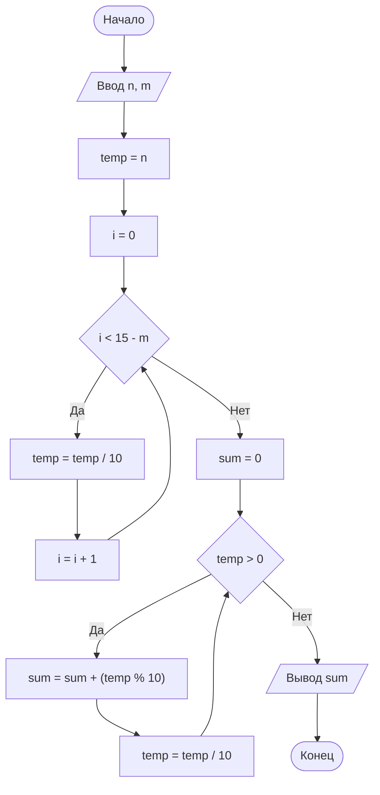

# Домашнее задание к работе 9

## Условие задачи

Написать программу вычисления суммы первых m цифр пятнадцатиразрядного числа n (n — длинное целое).

## 1. Алгоритм и блок-схема

**Алгоритм решения:**
1. НАЧАЛО
2. Ввести 15-значное число n и количество цифр m.
3. Присвоить переменной temp значение n.
4. Запустить цикл от 1 до (15 - m), в котором делить temp на 10 (отбрасываем лишние цифры с конца).
5. Инициализировать переменную sum = 0.
6. Запустить цикл while (пока temp > 0): добавить (temp % 10) к sum, затем разделить temp на 10.
7. Вывести результат sum.
8. КОНЕЦ

**Блок-схема:**


## 2. Реализация программы

Код программы находится в файле `main.c` в этом же репозитории.

## 3. Результаты работы программы

```text
введите 15-значное число: 123456789012345
введите количество первых цифр для суммы (m): 3
сумма первых 3 цифр равна: 6
```

## Информация о разработчике
Студент: Любых Егор Евгеньевич
Группа: бИЦТ-261
Вариант: 19
Дисциплина: Основы программирования и алгоритмизации
Руководитель: О. В. Минакова
